# PathSnap: Map-Matching and Route Reconstruction – Technical Report

**Course:** UE24CS352A Machine Learning, PES University (RR Campus) · **Hackathon:** PathSnap

**Repository layout:** `pathsnap/` (library) · `scripts/01–07` (experiments) · `api/` · `ui/` · `artifacts/` (models) · `results/` (all outputs).

Every number in this report is read from a file in `results/` that the scripts produce (random seed 42 throughout). Re-running `scripts/01`–`07` reproduces them.

---

## 1. Problem and approach

GPS fixes recorded at about 1 Hz are noisy: typically 5–15 m off the road, sometimes much more. The task is to assign each fix to the **directed road arc** the vehicle was actually on. The result should be a coherent route through the road network.

Our pipeline:

```
raw trip → per-trip metric projection → candidate arcs (≤10 within 80 m)
         → 20 features per (GPS point, candidate) → classifier P(correct arc)
         → HMM over candidates + Viterbi decoding → route → FastAPI → UI
```

The problem is framed as **candidate ranking**:

- One row per (GPS point, candidate arc), labelled 1 if the candidate is the reference arc.
- The classifier scores every candidate.
- The HMM then picks one candidate per point, taking road connectivity into account.

---

## 2. Dataset understanding and EDA

*Partitions:* every analysis in this section uses **train (80 trips)** and **student_test (10 trips)**. The evaluator partition was never accessed.

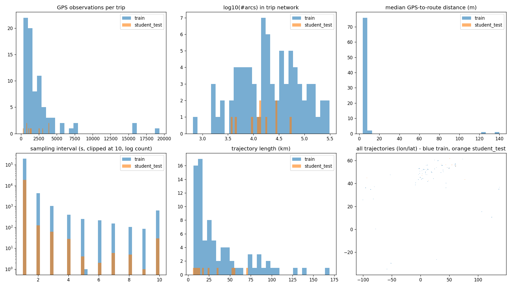

### 2.1 Structure (`results/eda/inventory.csv`, `summary.csv`)

| | Train | Student-test |
|---|---|---|
| Trips | 80 | 10 |
| GPS points: total (min / mean / max per trip) | 208,417 (361 / 2,605 / 19,313) | 19,160 (262 / 1,916 / 3,958) |
| Steps exactly 1 s apart | 93.8 % | 98.2 % |
| Trips with a gap > 60 s | 22 | 1 |
| Road arcs per trip: mean / max | 48,461 / 307,392 | 18,504 / 56,027 |
| Weakly connected components per network (mean) | 39.0 | 22.7 |
| NaNs / duplicate timestamps / unsorted timestamps / isolated nodes | 0 / 0 / 0 / 0 | 0 / 0 / 0 / 0 |
| Consecutive route arcs connected | 99.93 % | 99.97 % |
| Median distance GPS → reference route | 4.6 m | 4.7 m |

**What each file means, and how the files relate.**

- `.track` holds the GPS fixes: longitude, latitude, time.
- `.nodes` holds the road-network nodes (longitude, latitude); the row index is the node id.
- `.arcs` holds directed road segments as (from node, to node); the row index is the arc id. A two-way street therefore appears as **two arcs**.
- `.route` is the chronological list of arc ids the vehicle drove.
- A GPS row does **not** correspond to a route row: one arc usually spans many fixes.

**Patterns observed**

1. **Each trip ships its own road network.** All 90 `.arcs` files are different, so every step (indexing, features, HMM) works per trip.
2. **Trips are spread worldwide:** latitude −34.6° to 61.7°, longitude −100.4° to 137.2°. One global planar projection would distort distances. We therefore use a **local equirectangular projection centred on each trip**, which has under 0.1 % error at city scale, far below GPS noise. Plain Euclidean distance in degrees would be wrong: one degree of longitude shrinks with cos(latitude).
3. **Gaps and spikes:**
   - The largest time gap is 153,064 s.
   - 20 trips contain one-second jumps faster than 60 m/s, which are physically implausible GPS spikes.
4. **Partial reference routes:** in trips 2, 33 and 54, more than 5 % of the GPS points lie over 75 m from the route. The route only covers part of the drive.

### 2.2 Missing values and data quality (`results/eda/data_quality.png`, `anomalies.csv`)

There are no NaNs, duplicate timestamps or unsorted rows. The data-quality issues are **gaps** (dt > 10 s), **speed spikes** (> 60 m/s), and **GPS points far from the reference route**. 43 trips are listed in `anomalies.csv`.

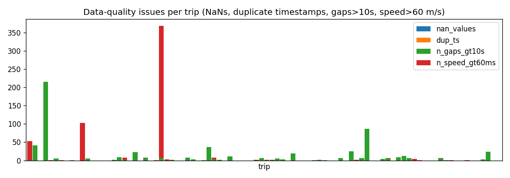

### 2.3 Road network and Folium map

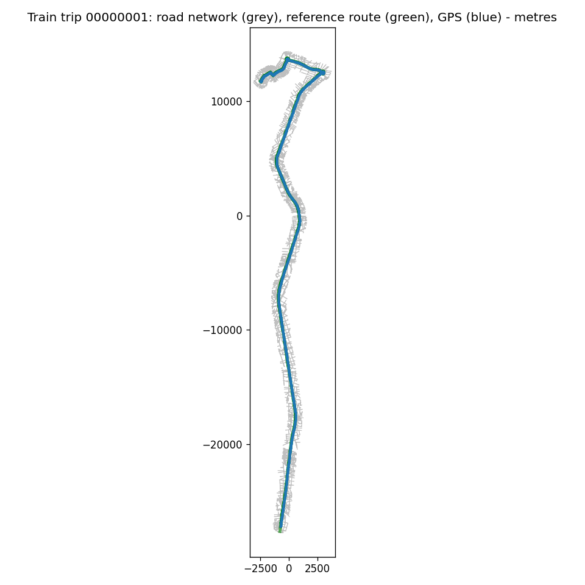

The interactive maps are `results/maps/eda_train_00000001.html` and `eda_train_00000002.html` (layer control, legend). Trip 2 shows the GPS outliers mentioned above.

### 2.4 Preprocessing

1. Sort fixes by timestamp, then project nodes and fixes to metres per trip (`pathsnap/data.py`).
2. **Per-point reference labels** (`pathsnap/labels.py`). The route is only an ordered arc list, so each GPS point is aligned to a route arc with a **monotone dynamic programme**: D[i,j] = c(i,j) + min over k ≤ j of D[i−1,k]. Here c(i,j) is the point-to-arc distance, capped at 100 m. Monotonicity stops a point snapping to a later or earlier part of the route that passes nearby (loops, U-turns).
3. Points whose aligned arc is more than **75 m** away are labelled "no reference" and excluded from scoring: 2.1 % of train points, 0.05 % of student-test points.
4. Limitation: these labels are derived and **not independently verified**. They inherit any errors in the supplied route.

### 2.5 Candidate generation and features (`pathsnap/candidates.py`)

- Every arc is sampled every 10 m and indexed in a KD-tree. For each fix we keep the **10 nearest arcs within 80 m**, using exact point-to-segment distance.
- On average there are **8.35 (train) / 8.24 (student-test)** candidates per point.
- **Candidate miss rate**, the share of points whose reference arc is not among the candidates: **1.20 % (train), 0.16 % (student-test)**. This caps the achievable Top-1 accuracy.

| Feature group | Features | Why |
|---|---|---|
| Distance | `dist`, `rank`, `dist_minus_min`, `dist_ratio`, `n_cand` | The nearest road is usually right, but noise makes absolute distance unreliable. Relative distance to the best candidate generalises across trips. |
| Direction | `head_diff`, `head_cos`, `head_diff_long` (±1 and ±4 point windows), `speed` | Two-way streets have two arcs with identical geometry; only the direction of travel separates them. The long window is robust to jitter. |
| Temporal context | `dist_prev`, `dist_next`, `dist_win_mean`, `dist_win_rank` (±3 points) | A road that stays close over several seconds is more likely than one a single noisy fix happens to touch. |
| Geometry / topology | `arc_len`, `t_proj`, `t_clipped`, `has_reverse`, `out_degree`, `in_degree` | Projection falling past the arc end, intersections, and whether a reverse twin exists. |
| Sampling | `dt_prev` | Marks gaps. |

**Feature importance of the final model** (LightGBM split gain, `results/report_figures/lgbm_feature_importance.csv`): `dist_minus_min` 26.2 %, `head_diff_long` 21.2 %, `dist_win_rank` 12.8 %, `rank` 7.3 %, `dist_ratio` 5.6 %, `head_diff` 4.9 %. These confirm the design: **relative distance, direction, and temporal context** carry most of the signal.

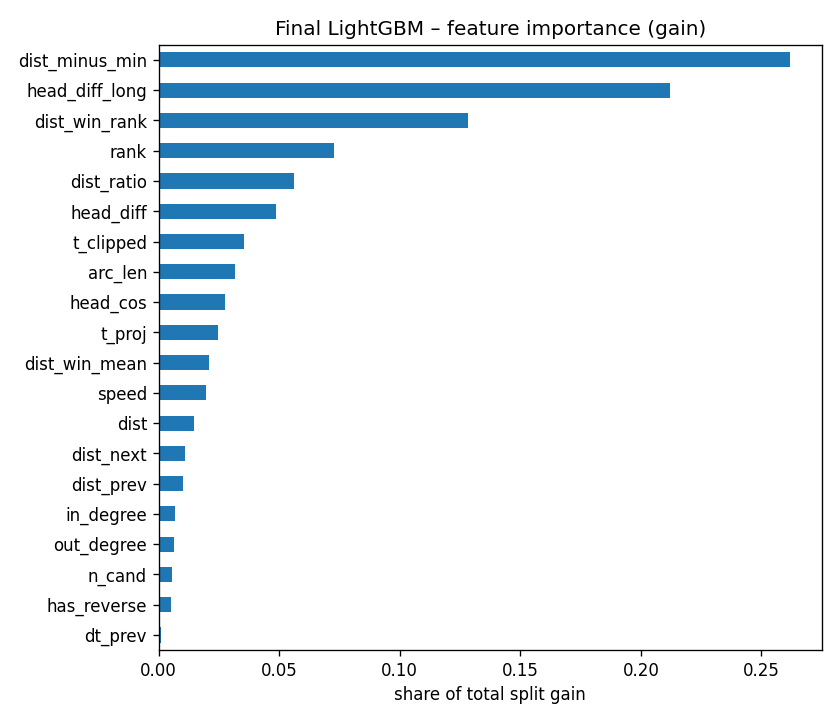

### 2.6 Feature selection (`scripts/03b_feature_selection.py`, `results/feature_selection/`)
All experiments use LightGBM with 5-fold trip-grouped CV on the **training trips only**.

**Redundancy check** (Spearman correlation, train): `head_diff` and `head_cos` are perfectly correlated (ρ = −1.00), since one is a transform of the other. The distance features are strongly correlated with each other: `dist` vs `dist_minus_min` 0.93, `rank` vs `dist_win_rank` 0.89. Fifteen pairs have |ρ| > 0.8 (`highly_correlated_pairs.csv`).

**Group ablation** (remove one feature group, re-run CV):

| Experiment | # features | CV Macro F1 | Δ Macro F1 | CV Top-1 | Δ Top-1 |
|---|---|---|---|---|---|
| All features | 20 | 0.9367 | – | 0.8889 | – |
| without distance | 15 | 0.9338 | −0.0030 | 0.8865 | −0.0023 |
| without **direction** | 16 | **0.7678** | **−0.1689** | **0.6143** | **−0.2746** |
| without temporal context | 16 | 0.9321 | −0.0046 | 0.8793 | −0.0095 |
| without geometry / topology | 14 | 0.9303 | −0.0064 | 0.8830 | −0.0059 |
| without sampling (`dt_prev`) | 19 | 0.9373 | +0.0006 | 0.8899 | +0.0011 |

**Importance-based top-k selection** (ranked by gain on the training trips):

| Top-k features | 5 | 10 | 15 | 20 |
|---|---|---|---|---|
| CV Macro F1 | 0.9302 | 0.9351 | 0.9366 | 0.9367 |
| CV Top-1 | 0.8801 | 0.8880 | 0.8891 | 0.8887 |

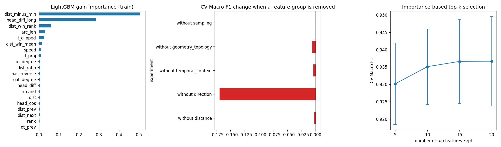

**Findings and decision**

- **Direction features are essential.** Without them the model can't separate the two directions of a two-way road (identical geometry), and Top-1 collapses by 27 points.
- Removing distance features alone costs little, because the temporal-context features also encode distance and are correlated with them. They are still kept, since they are the top-ranked features.
- `dt_prev` adds nothing (+0.0006, within the ±0.013 fold standard deviation), and `head_cos` duplicates `head_diff`.
- The **top 15 features reach the same CV score as all 20.** The differences are far below the fold-to-fold variation.
- **Decision:** we keep all 20 features. The reduced set is not significantly better, tree models are robust to redundant features, and the model comparison and tuning were run with 20 features. The 15-feature set is a valid, simpler alternative.

---

## 3. Model experimentation and comparison

**Protocol** (`scripts/03_train_models.py`, `pathsnap/modeling.py`)

- **5-fold GroupKFold by trip** on the 80 training trips, so no trip appears in both a training and a validation fold.
- Every 3rd GPS point is used (477,737 candidate rows, 12.9 % positive), because consecutive 1 Hz fixes are nearly duplicates.
- The model is then refit on all training trips and evaluated on **all labelled points of the 10 student-test trips** (151,933 rows).

**Metrics**

- *Macro F1*: binary candidate classification (correct arc vs not) at threshold 0.5, averaged over both classes. Macro averaging matters because only about 13 % of rows are positive.
- *Top-1 accuracy*: the share of GPS points whose highest-scoring candidate is the reference arc. This is the **primary route-matching metric**.
- *Log loss*: probability quality, which matters because the HMM uses the probabilities as emissions.
- *Route continuity*: the share of consecutive points whose predicted arcs are equal or directly connected.
- *Inference time*: milliseconds per GPS point.

### 3.1 Overall comparison (`results/models/model_comparison.csv`)

| Model | Family | Key configuration | CV Macro F1 (± std) | ST Top-1 | ST Route continuity | ST Macro F1 | ST Log loss | Inference (ms/pt) |
|---|---|---|---|---|---|---|---|---|
| M1 Logistic Regression | Linear | scaler + L2, C=1 | 0.9318 ± 0.011 | 0.8848 | 0.9499 | 0.9286 | 0.0888 | 0.001 |
| M2 Gaussian NB | Probabilistic | defaults | 0.8684 ± 0.020 | 0.8453 | 0.9299 | 0.8637 | 0.5770 | 0.001 |
| M3 KNN | Instance-based | scaler, k=25, distance-weighted, 150k rows | 0.9289 ± 0.011 | 0.8831 | 0.9410 | 0.9267 | 0.1177 | 1.133 |
| M4 Decision Tree | Tree | depth 12, min_leaf 50 | 0.9321 ± 0.011 | 0.8849 | 0.9453 | 0.9312 | 0.0846 | 0.001 |
| M5 Random Forest | Bagging | 200 trees, depth 18, min_leaf 5 | **0.9376** ± 0.010 | 0.8909 | 0.9514 | 0.9355 | 0.0693 | 0.020 |
| M6 HistGradientBoosting | Boosting | 300 iters, lr 0.1 | 0.9353 ± 0.012 | 0.8927 | 0.9493 | 0.9346 | 0.0706 | 0.016 |
| M7 **LightGBM** | Boosting | 400 trees, lr 0.05, 63 leaves | 0.9367 ± 0.013 | **0.8991** | **0.9541** | **0.9378** | **0.0677** | 0.027 |
| M8 MLP | Neural network | scaler, (64, 32), Adam, early stopping | 0.9297 ± 0.013 | 0.8947 | 0.9529 | 0.9318 | 0.0732 | 0.003 |

*ST = student-test. Top-1 and continuity are classifier-only (no HMM). CV Top-1 values are in the CSV.*

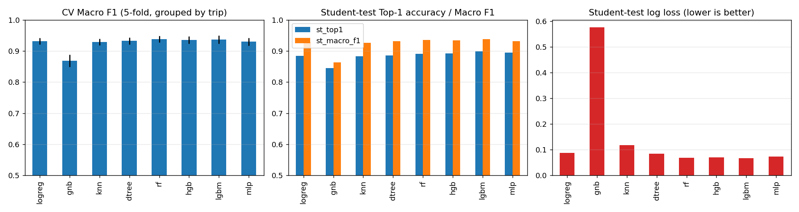

**Model selection: LightGBM.**

1. Its CV Macro F1 (0.9367) is within one fold standard deviation of the best, Random Forest (0.9376 ± 0.010), so the two are statistically tied on CV.
2. It is best on every student-test metric: Top-1, Macro F1, log loss and continuity.
3. It has the best-calibrated probabilities (lowest log loss), and those feed the HMM directly.
4. It fits in 4.2 s against 143 s for Random Forest, so a 30-trial Bayesian search (150 model fits) is practical.

The **primary selection metric** is CV Macro F1, backed up by student-test Top-1 accuracy, because Top-1 is what the route depends on.

### 3.2 Per-model analysis

"Train F1" below is the Macro F1 on the training folds (first 200k rows of each fold), averaged over folds. It is compared with CV F1 to judge over- or underfitting.

#### M1 – Logistic Regression

- **Why suitable:** most features are monotone signals (closer is better, a smaller heading difference is better), which a linear log-odds model represents well. It gives calibrated probabilities and is a good baseline.
- **Strengths / limitations:** fastest model (1 s fit) and interpretable. It cannot model interactions, for example "heading matters only when speed is high", nor thresholds such as "the projection falls past the arc end".
- **Hyperparameters:** StandardScaler; L2 penalty, C = 1.0; lbfgs, max_iter 2000.
- **Objective:** L2-regularised binary log loss.
- **Student-test:** Top-1 0.8848, Macro F1 0.9286, log loss 0.0888, precision 0.868, recall 0.884.
- **Over/underfitting:** train F1 0.9304 vs CV F1 0.9318, essentially equal. The model has **no variance problem but is capacity-limited (mild underfitting)**: every nonlinear model with interactions beats it on CV.

#### M2 – Gaussian Naive Bayes

- **Why suitable:** a very cheap generative baseline that tests whether the features are informative on their own.
- **Strengths / limitations:** trains in 0.1 s. It assumes the features are independent and Gaussian, which is badly violated here: `dist`, `dist_ratio`, `dist_minus_min` and `dist_win_mean` are strongly correlated, and distances are skewed.
- **Hyperparameters:** defaults (var_smoothing 1e-9).
- **Objective:** maximum-likelihood class-conditional Gaussians.
- **Student-test:** Top-1 0.8453, Macro F1 0.8637, **log loss 0.5770**, precision 0.653, recall 0.935.
- **Over/underfitting:** train 0.8543 vs CV 0.8684, a clear **underfit**. Counting correlated evidence several times makes it **overconfident**: its log loss is 8× LightGBM's, and its precision is low because many wrong candidates get high probability. This makes it unsuitable as an HMM emission model.

#### M3 – K-Nearest Neighbours

- **Why suitable:** similar feature patterns, such as "close, aligned, consistently near", should share labels. KNN needs no assumption about the shape of the decision boundary.
- **Strengths / limitations:** simple and non-parametric. It needs feature scaling, every scaled feature counts equally in the distance metric (uninformative features add noise), and prediction is the slowest of all models (1.13 ms per point). We had to subsample to 150k training rows to keep CV under 4 minutes.
- **Hyperparameters:** StandardScaler; k = 25; distance weighting; Euclidean metric.
- **Objective:** none (lazy learner); prediction is a distance-weighted vote.
- **Student-test:** Top-1 0.8831, Macro F1 0.9267, log loss 0.1177.
- **Over/underfitting:** **train F1 1.000 vs CV 0.9289, clear overfitting.** With distance weighting each training row is its own nearest neighbour, so the model memorises the training data. Its probabilities are also coarse (multiples of the vote weights), which explains the second-worst log loss.

#### M4 – Decision Tree

- **Why suitable:** learns threshold rules directly, for example "dist_minus_min < x and head_diff_long < y", and handles mixed feature scales without scaling.
- **Strengths / limitations:** interpretable and the fastest at inference (0.0005 ms per point). A single tree has high variance, and its probabilities are piecewise constant.
- **Hyperparameters:** max_depth 12, min_samples_leaf 50 (both limit variance); Gini criterion.
- **Objective:** greedy Gini-impurity minimisation.
- **Student-test:** Top-1 0.8849, Macro F1 0.9312, log loss 0.0846.
- **Over/underfitting:** train 0.9413 vs CV 0.9321, a small gap. Depth and leaf limits keep it from overfitting, but a single tree can't match the ensembles (−0.005 CV F1 vs RF).

#### M5 – Random Forest

- **Why suitable:** averaging many decorrelated deep trees reduces the variance that M4 showed, while keeping nonlinear rules and interactions.
- **Strengths / limitations:** **best CV Macro F1 (0.9376)** and the lowest fold standard deviation (0.010), so it is the most stable across trips. However, it is the slowest to train (143 s on 8 cores) and the largest artifact (35 MB).
- **Hyperparameters:** 200 trees, max_depth 18, min_samples_leaf 5, bootstrap, √features per split.
- **Objective:** Gini impurity per tree; prediction is the average of tree probabilities.
- **Student-test:** Top-1 0.8909, Macro F1 0.9355, log loss 0.0693, precision 0.905, recall 0.869.
- **Over/underfitting:** train 0.9637 vs CV 0.9376. The gap (0.026) shows some memorisation by the deep trees, but CV is the best of all models, so the ensemble averaging controls it.

#### M6 – HistGradientBoosting

- **Why suitable:** boosting fits residual errors one after another, so it focuses on the hard, ambiguous candidates (two-way roads, parallel streets). The histogram binning makes it fast on 478k rows.
- **Strengths / limitations:** strong accuracy at a 2.8 s fit. Default regularisation only; it was not tuned.
- **Hyperparameters:** max_iter 300, learning_rate 0.1, max_leaf_nodes 31. `early_stopping='auto'` switches early stopping **on** for more than 10,000 rows: 10 % validation split, patience 10.
- **Objective:** binary log loss (gradient boosting).
- **Student-test:** Top-1 0.8927, Macro F1 0.9346, log loss 0.0706.
- **Over/underfitting:** train 0.9466 vs CV 0.9353, a moderate and healthy gap.

#### M7 – LightGBM (selected)

- **Why suitable:** the same boosting idea as M6, with leaf-wise growth and many regularisation controls. It is well suited to tabular, heterogeneous features, and it gives well-calibrated probabilities for the HMM.
- **Strengths / limitations:** best on student-test and fast to train. Leaf-wise trees with 63 leaves can overfit, which is why we tuned it (Section 4). Fold standard deviation is the highest of the tree models (0.013).
- **Hyperparameters (untuned):** n_estimators 400, learning_rate 0.05, num_leaves 63, min_child_samples 20, no subsampling, reg_lambda 0.
- **Objective:** binary log loss.
- **Student-test:** Top-1 **0.8991**, Macro F1 **0.9378**, log loss **0.0677**, precision 0.907, recall 0.876.
- **Over/underfitting:** train 0.9666 vs CV 0.9367, a gap of 0.03. It fits the training trips more closely than the CV trips. Even so, it generalises best to the unseen student-test trips, so the extra capacity captures real structure rather than just noise.

#### M8 – Multi-layer perceptron

- **Why suitable:** learns smooth nonlinear combinations of the scaled features, and the network's output is a probability.
- **Strengths / limitations:** competitive student-test Top-1 (0.8947) and good continuity (0.9529). Slow to train (76 s), sensitive to scaling and initialisation. Fold standard deviation is 0.013, similar to LightGBM.
- **Hyperparameters:** StandardScaler; hidden layers (64, 32), ReLU; Adam; L2 alpha 1e-4; batch 200; early stopping on a 10 % validation split (patience 10); max_iter 60.
- **Objective:** binary cross-entropy + L2.
- **Student-test:** Top-1 0.8947, Macro F1 0.9318, log loss 0.0732.
- **Over/underfitting:** train 0.9477 vs CV 0.9297. The training history below shows training loss falling from 0.101 to 0.061 over 48 epochs. Validation accuracy peaks at epoch 37 (0.9768) and then flattens, so early stopping ended training before validation performance degraded.

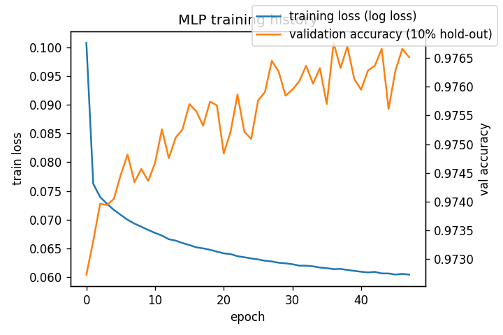

*Only the MLP produces an epoch-wise training history; we did not draw curves for the other models.*

### 3.3 Diagnostic visualisations

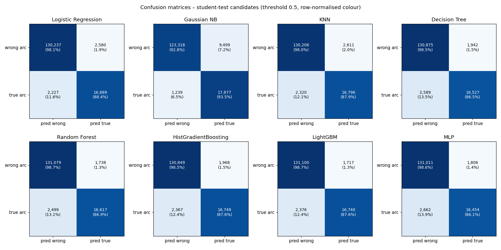

The confusion matrices show the precision/recall trade-off at threshold 0.5. Gaussian NB recovers the most true arcs (93.5 % recall) but also accepts many wrong ones, which is its low precision. The tree ensembles and LightGBM are the most balanced. Threshold choice does not affect Top-1 or the HMM, since both use relative scores within each GPS point.

---

## 4. Bayesian hyperparameter optimisation (LightGBM)

`scripts/04_bayes_opt.py`, outputs in `results/bayes/`.

1. **Hyperparameters searched:** n_estimators, learning_rate, num_leaves, min_child_samples, subsample (bagging fraction, freq 1), colsample_bytree, reg_lambda.
2. **Ranges / distributions:**
   - n_estimators: integer 100–800, step 50
   - learning_rate: 0.01–0.2, log-uniform
   - num_leaves: 15–255, log-uniform integer
   - min_child_samples: 5–200, log-uniform integer
   - subsample: 0.5–1.0
   - colsample_bytree: 0.4–1.0
   - reg_lambda: 1e-3–10, log-uniform

   Log scales are used for parameters whose effect is multiplicative.
3. **Objective:** maximise mean **5-fold GroupKFold (by trip) Macro F1** on the 80 training trips. Student-test data is not used.
4. **Trials:** **30** with Optuna's **TPE sampler** (seed 42, the first 10 random for exploration). It took 1,546 s, about 26 minutes, for 150 model fits. Search record: `results/bayes/trials.csv`.
5. **Best values:** n_estimators **600**, learning_rate **0.0140**, num_leaves **221**, min_child_samples **12**, subsample **0.623**, colsample_bytree **0.486**, reg_lambda **0.171**.

   The search preferred **many small boosting steps on large trees, combined with strong row and column subsampling** for regularisation. fANOVA importance: reg_lambda 0.29, min_child_samples 0.21, n_estimators 0.20, num_leaves 0.13.

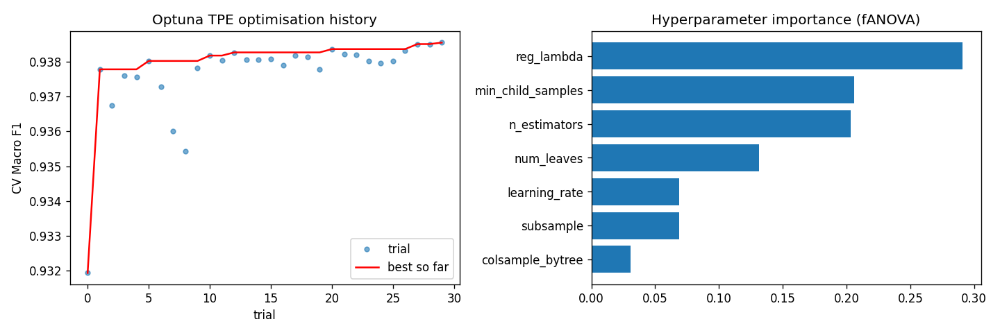

6. **Did tuning help?** (`results/bayes/tuned_vs_untuned.csv`; same partitions and metrics for both)

| | CV Macro F1 | ST Top-1 | ST Macro F1 | ST Log loss | Inference (ms/pt) |
|---|---|---|---|---|---|
| LightGBM untuned | 0.9367 ± 0.013 | **0.8991** | **0.9378** | 0.0677 | **0.034** |
| LightGBM tuned | **0.9386** ± 0.012 | 0.8945 | 0.9369 | **0.0677** | 0.087 |

**Interpretation:**

- Tuning improved the **objective** and every CV metric: CV Top-1 0.8889 → 0.8908, CV log loss 0.0774 → 0.0732, and a smaller fold standard deviation.
- The gain (+0.0019) is **smaller than the fold standard deviation**, and on the student-test trips the tuned model is slightly **worse** in Top-1 (−0.46 pt) and 2.6× slower at inference.
- The best random start-up trial already reached 0.9380, and TPE added only 0.0006 on top. The objective surface is flat near the defaults, so we see **diminishing returns**.
- We still deploy the tuned model, because the selection rule was fixed in advance to training-trip CV. Picking the untuned model on the strength of the student-test result would mean tuning on test data.
- Inference is 0.087 ms per point, under 0.4 s for the largest student-test trip, so the slowdown does not matter in practice.

---

## 5. HMM and Viterbi route reconstruction

`pathsnap/hmm.py`, `scripts/05_hmm_eval.py`, outputs in `results/hmm/`.

1. **Hidden states:** at time t, the candidate arcs C_t of GPS point t (at most 10). Each state keeps its arc id and the projection fraction `t_proj` along the arc, so the candidate-to-arc mapping is preserved through decoding.
2. **Emission probabilities:** log P(z_t | arc) = **α · log p̂(arc | z_t)**. Here p̂ is the LightGBM probability **normalised over the candidates of point t**, with a floor of 1e-4. α controls how much the decoder trusts the classifier compared with the road network.
3. **Transition probabilities** (in the style of Newson & Krumm):
   - d_net = remaining length of arc a + shortest path from a's end node to b's start node + length into b. The shortest path comes from **Dijkstra on the arc-length-weighted directed graph**, with a search limit of 3·d_gc + 150 m and results cached per source node.
   - If a = b, d_net is the forward progress along the arc. Small backward moves (≤ 10 m) count as GPS jitter; larger ones are penalised.
   - d_gc is the straight-line distance between the two GPS fixes.
   - **log P(b | a) = −|d_net − d_gc| / β.** A route whose driving distance matches the observed displacement is likely; detours and teleports are not.
4. **Missing candidates and large gaps:**
   - Every point always has at least one candidate: if nothing is within 80 m, the nearest arcs are used.
   - If **dt > 60 s or d_gc > 500 m**, the transition is **flat**. The chain restarts, so each side of the gap is decoded from its own evidence instead of forcing a long, uncertain path through the network.
5. **Disconnected consecutive segments:** if b can't be reached from a within the search limit, the transition gets a large finite penalty (log P = −50) rather than −∞. Decoding therefore never fails. A disconnected step is still chosen when the evidence for it is overwhelming, for example network gaps between the 39 components or one-way errors in the data.

**Viterbi:** δ_t(b) = max over a of [δ_{t−1}(a) + log P(b|a)] + α·log p̂_t(b), with back-pointers. Scores are re-centred every step for numerical stability. This is linear in the number of points and quadratic in the number of candidates (≤ 100 pairs per step).

**Decoder tuning without leakage:**

- α ∈ {0.5, 1, 2} × β ∈ {2, 5, 10, 20, 50} m were grid-searched on **out-of-fold** LightGBM probabilities of the 80 training trips (5-fold by trip, tuned parameters).
- **Best: α = 0.5, β = 10 m.** Out-of-fold Top-1 rises from 0.8972 (classifier only) to 0.9262 (HMM) (`decoder_grid_oof_train.csv`).
- α < 1 means the decoder should **lean on the road network more than on the classifier**.

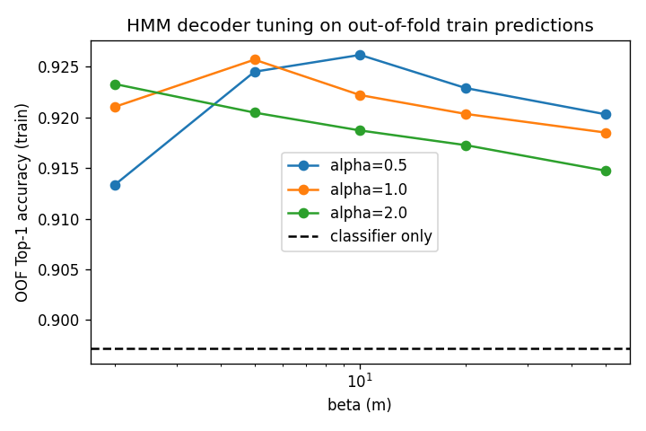

6. **Did HMM decoding improve the route?** Yes, on **every** student-test trip.

| Trip | Top-1: classifier | Top-1: + HMM | Continuity: classifier | Continuity: + HMM | Route F1: classifier | Route F1: + HMM |
|---|---|---|---|---|---|---|
| 00000000 | 0.9541 | **0.9632** | 0.9813 | 0.9960 | 0.9144 | 0.9558 |
| 00000007 | 0.9365 | **0.9941** | 0.9985 | 1.0000 | 0.9837 | 0.9837 |
| 00000009 | 0.8894 | **0.9180** | 0.9122 | 0.9485 | 0.8637 | 0.8840 |
| 00000040 | 0.9499 | **0.9639** | 0.9804 | 0.9957 | 0.9472 | 0.9722 |
| 00000052 | 0.9809 | **1.0000** | 0.9540 | 0.9617 | 0.8814 | 0.9266 |
| 00000056 | 0.9225 | **0.9672** | 0.9227 | 0.9674 | 0.9119 | 0.9340 |
| 00000065 | 0.8711 | **0.8919** | 0.9674 | 0.9870 | 0.9091 | 0.9470 |
| 00000076 | 0.9266 | **0.9711** | 0.9285 | 0.9737 | 0.8812 | 0.9129 |
| 00000077 | 0.7561 | **0.8369** | 0.9637 | 0.9923 | 0.8885 | 0.9369 |
| 00000091 | 0.9073 | **0.9291** | 0.9251 | 0.9714 | 0.8485 | 0.8633 |
| **Mean over trips** | 0.9094 | **0.9435** | 0.9535 | **0.9794** | 0.9030 | **0.9316** |
| **Pooled over all points** | 0.8945 | **0.9348** | | | | |

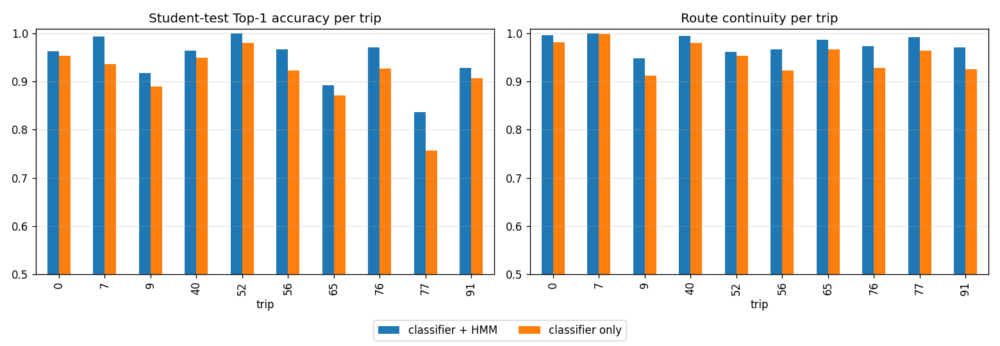

**Where the HMM helps:**

- It removes isolated jumps onto side streets and parallel roads (continuity 0.954 → 0.979).
- It fixes direction flips, since a sudden switch to the reverse arc implies a U-turn whose d_net doesn't match d_gc.
- Route precision rises from 0.914 to 0.963.

**Where it doesn't help, and why:**

- **Route recall barely changes (0.896 → 0.906).** This is a property of the data rather than of the decoder. Some route arcs are so short that the vehicle crosses them between two 1 Hz fixes, so no GPS point is ever labelled with them. Even perfect per-point labels would reach only **0.905 mean recall**, and the HMM already sits at that ceiling. Recovering these arcs needs **path interpolation** (inserting the shortest path between consecutive matched arcs), which would be a natural extension.
- **Trip 77 is still the weakest (0.837).** Of its 638 remaining errors, **77 % choose the reverse-direction twin of the correct arc**, 12 % are the neighbouring arc at a segment boundary, and 11 % are other arcs. Trip 65 shows the same pattern (59 % reverse direction). In the window shown below (points 2263–2563), 122 of the 124 points where the classifier and HMM disagree are such direction twins. The HMM is right on 85.3 % of the window's points, the classifier alone on 52.7 %. The GPS there is a dense scatter on a short two-way road, so the heading features are unreliable. Direction ambiguity on two-way roads is our main remaining error source.

---

## 6. Geographical visualisation (Folium)

`pathsnap/viz.py`. One interactive map per student-test trip is in `results/maps/student_test_*.html`, plus EDA and focus maps. Every map has:

- **Layers:** road network near the track (grey), reference route (green, wide), classifier-only top-1 arcs (orange, toggleable), HMM/Viterbi prediction (magenta), raw GPS points (blue dots with timestamp tooltips), start and end markers.
- A legend and a **layer control**.
- An extent fitted to the trajectory.

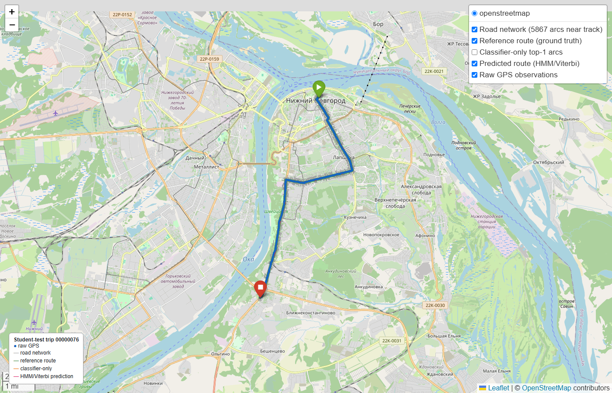

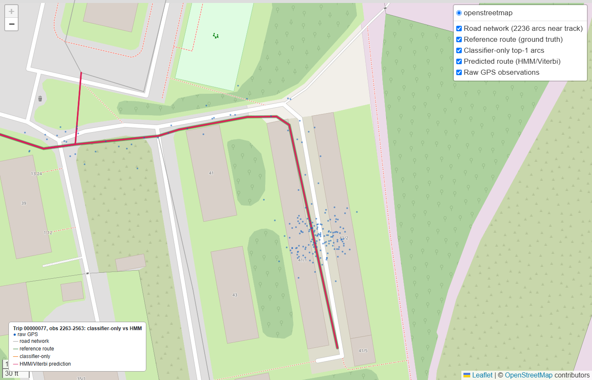

---

## 7. API, UI and deployment

**Laptop 1, API** (`api/main.py`, FastAPI + uvicorn, `uvicorn api.main:app --host 0.0.0.0 --port 8000`):

- At start-up it loads `artifacts/final_model.joblib` (tuned LightGBM + feature list) and `artifacts/hmm_config.json` (α, β, gap thresholds). It lists the evaluation trips in `PATHSNAP_EVAL_DIR`.
- `GET /health` reports the model and decoder settings. `GET /trips` returns the trip ids. `POST /predict {"trip_id"}` runs the full pipeline:
  1. load the trip **without** its route
  2. generate candidates and features
  3. run LightGBM
  4. run the HMM/Viterbi decoder
  5. only then, `score_trip()` reads the `.route` server-side and computes Top-1, continuity and route P/R/F1
- The response contains the predicted polylines, the arc chosen for each point, the metrics and the timing. **The reference route is never returned.** Every request is logged to the console.

**Laptop 2, UI** (`ui/index.html`, served by `ui/serve.py` on port 8501): enter the API address, load the 10 trips, select one, and click *Reconstruct route*. The UI draws the GPS points and the predicted route on an OpenStreetMap basemap (Leaflet), plus a table comparing classifier-only and HMM metrics.

All 10 student-test trips were tested through the API, at 0.2–3.3 s per request. The scores match the offline evaluation exactly.

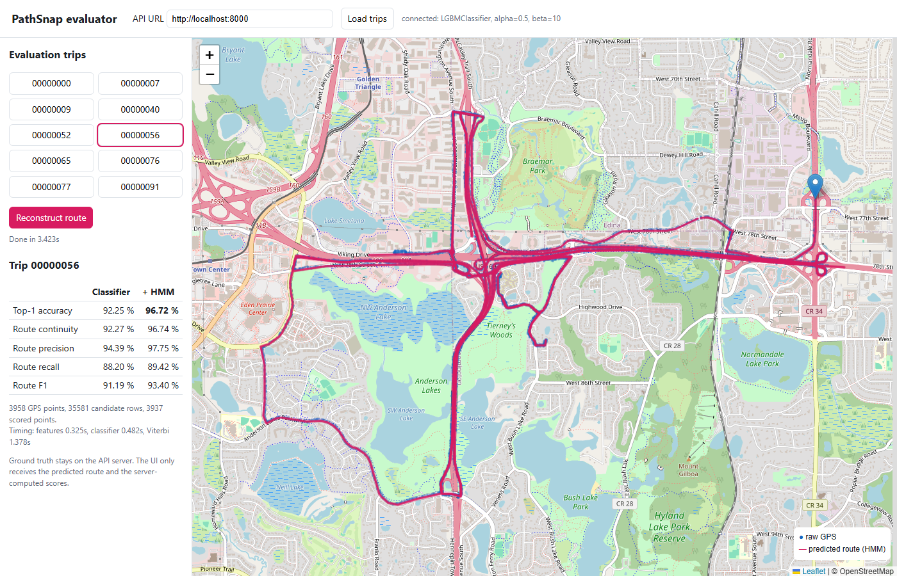

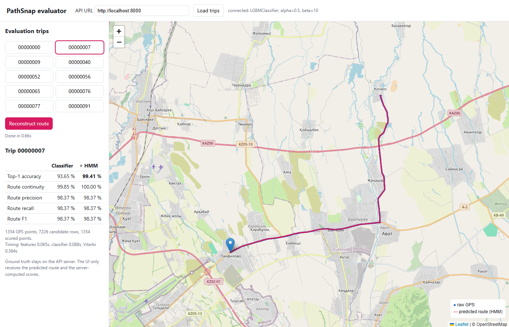

**API console (CMD) receiving requests from the UI.** This is a screenshot of the CMD window running `run_api.bat`, taken while the UI requested student-test trips 7, 77 and 56. Each `POST /predict` is logged with the trip, the number of GPS points, the server-side Top-1 (HMM and classifier-only), the route continuity and the processing time. For this capture the API and the UI ran on the same laptop. At evaluation, the API runs on Laptop 1, the UI on Laptop 2, and the log appears in the same way on Laptop 1.

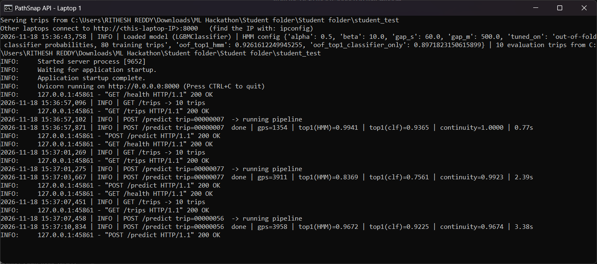

---

## 8. Leakage controls, limitations and conclusions

**Leakage controls**

- All CV is grouped by trip.
- Model hyperparameters were tuned on training-trip CV only. Decoder parameters were tuned on out-of-fold training predictions only.
- Student-test data was used only for comparison, and the evaluator partition was never opened.
- Scaling is fitted on training data inside each pipeline.
- No predictions are hard-coded, and reference routes are read only for scoring.

**Limitations**

- Labels come from the supplied routes through our alignment, so they are not independent ground truth.
- 1.2 % of training points have no correct candidate.
- Direction ambiguity on two-way roads causes most remaining errors.
- Route recall is capped by unobserved short arcs; path interpolation would address this.

**Conclusion.** Candidate ranking with a tuned LightGBM (student-test Top-1 0.895, Macro F1 0.937), followed by an HMM over the road network, reconstructs routes with **93.5 % pointwise accuracy and 97.9 % continuity** on unseen trips. The HMM improves every trip, by 4.0 points of Top-1 overall.

---

## 9. Academic integrity and AI-use disclosure

AI assistance was used in this project. An AI coding assistant (Claude, Anthropic) helped write the source code, and helped draft this report from our experiment outputs. Every experiment was executed, and every metric, table, graph and map in this report is produced by the code in the repository and can be reproduced with `scripts/01`–`07`. The team has reviewed the methods and results and is responsible for the content.
