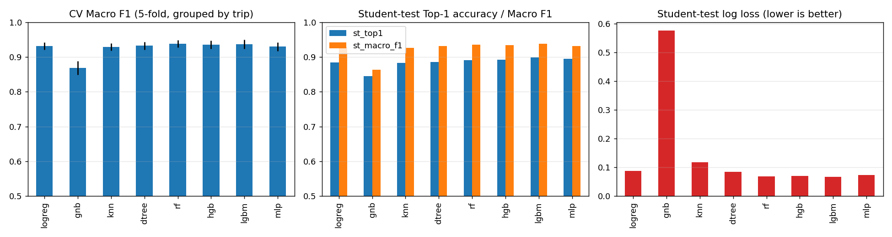

# PathSnap – Phase 1 Progress Report

**Task:** match noisy 1 Hz GPS trajectories to a directed road network and reconstruct the driven route.
**Phase 1 scope:** dataset exploration, preprocessing and labelling, candidate generation, feature engineering, and training and comparing the candidate classifiers.
**Full pipeline (planned):** raw trip → candidate road arcs → features → classifier → HMM/Viterbi → route → FastAPI + UI

All numbers below are from executed scripts. The source files are listed next to each table.

---

## 1. Dataset understanding (`scripts/01_eda.py`, `results/eda/`)

| | Train | Student-test |
|---|---|---|
| Trips | 80 | 10 |
| GPS points (total) | 208,417 | 19,160 |
| GPS points per trip (min / mean / max) | 361 / 2,605 / 19,313 | 262 / 1,916 / 3,958 |
| Steps exactly 1 s apart | 93.8 % | 98.2 % |
| Trips with a gap > 60 s | 22 | 1 |
| Road arcs per trip (mean / max) | 48,461 / 307,392 | 18,504 / 56,027 |
| NaN values / isolated nodes | 0 / 0 | 0 / 0 |
| Median GPS-to-route distance | 4.6 m | 4.7 m |

**Key observations**
- **Every trip has its own road network** (90 unique `.arcs` files). All processing is therefore done per trip.
- Trips are spread **worldwide** (Europe, North America, Asia, …). Each trip gets its own local equirectangular projection in metres, centred on that trip. Error is < 0.1 % at city scale, far below GPS noise.
- `.route` is an **ordered list of arcs, not one label per GPS row**. Consecutive route arcs connect in 99.9 % of cases.
- Anomalies: 43 trips are flagged in `anomalies.csv`. They include gaps up to 153,064 s, 1-second jumps > 60 m (GPS spikes), and partial routes. In trips 33 and 54 the route covers only part of the track.

## 2. Preprocessing & labels (`pathsnap/labels.py`)
- GPS points are sorted by timestamp and projected to metres.
- **Per-point labels** come from a *monotone dynamic-programming alignment* of GPS points to the route arcs. A point can only move forward along the route, so it can't snap to a parallel street or a later loop.
- Points more than 75 m from the route get no label (excluded from metrics). That is 2.1 % of train points and 0.05 % of student-test points.

## 3. Candidates & features (`pathsnap/candidates.py`)
- KD-tree over points sampled every 10 m along each arc. For each GPS point, keep up to **10 arcs within 80 m**.
- About 8.3 candidates per point. **Candidate miss rate: 1.2 % (train), 0.16 % (student-test).**
- 20 features per (GPS point, candidate arc):
  - distance and its rank, distance relative to the closest candidate
  - **heading difference** between GPS motion and arc direction, which separates the two directions of the same road
  - speed, arc length, projection position, whether the reverse arc exists
  - **distance of the previous/next ±3 points to the same arc** (temporal context)
  - node degrees, time gap

## 4. Model comparison (`scripts/03_train_models.py`, `results/models/model_comparison.csv`)
5-fold **GroupKFold by trip** on the 80 training trips (every 3rd point used, since 1 Hz points are highly correlated). Final evaluation is on the 10 student-test trips.

| Model | Family | CV Macro F1 | CV Top-1 | ST Top-1 | ST Macro F1 | ST Log loss | Route continuity | Fit time |
|---|---|---|---|---|---|---|---|---|
| Logistic Regression | Linear | 0.932 | 0.885 | 0.885 | 0.929 | 0.089 | 0.950 | 1 s |
| Gaussian NB | Probabilistic | 0.868 | 0.851 | 0.845 | 0.864 | 0.577 | 0.930 | 0.1 s |
| KNN (k=25) | Instance-based | 0.929 | 0.878 | 0.883 | 0.927 | 0.118 | 0.941 | 0.1 s* |
| Decision Tree | Tree | 0.932 | 0.883 | 0.885 | 0.931 | 0.085 | 0.945 | 11 s |
| Random Forest | Bagging | **0.938** | 0.889 | 0.891 | 0.936 | 0.069 | 0.951 | 143 s |
| HistGradientBoosting | Boosting | 0.935 | 0.887 | 0.893 | 0.935 | 0.071 | 0.949 | 3 s |
| **LightGBM** | Boosting | 0.937 | 0.889 | **0.899** | **0.938** | **0.068** | **0.954** | 4 s |
| MLP (64,32) | Neural net | 0.930 | 0.882 | 0.895 | 0.932 | 0.073 | 0.953 | 76 s |

\*KNN inference is the slowest at 1.1 ms per point. Its training Macro F1 is 1.00 against 0.93 in CV, a clear sign of overfitting.

**Selected model: LightGBM.** Its CV score is within one standard deviation of Random Forest (±0.010). It has the best student-test Top-1, Macro F1 and log loss, and the best probability quality, which matters for the planned HMM decoder. It also trains about 34× faster than RF.

## 5. Next phase
1. Bayesian hyperparameter optimisation of LightGBM (Optuna TPE, grouped CV objective).
2. HMM/Viterbi route reconstruction over the candidate arcs, with classifier-only vs HMM comparison.
3. FastAPI backend and evaluator UI (two-laptop deployment), plus Folium maps of predicted routes.
4. Final technical report.

---
*AI-assistance disclosure: code was developed with the help of an AI coding assistant (Claude). All results come from executed code in this repository.*
