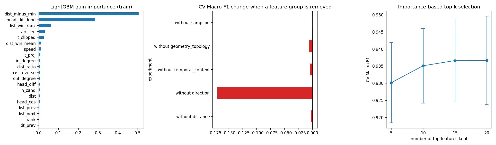

# PathSnap – Phase 1 Progress Report

**Task:** match noisy 1 Hz GPS trajectories to a directed road network and reconstruct the driven route.
**Phase 1 scope:** EDA, preprocessing and labelling, feature engineering and **feature selection**, training and comparing **8 ML algorithms**, and **Bayesian hyperparameter tuning** of the selected model.
**Full pipeline (planned):** raw trip → candidate road arcs → features → classifier → HMM/Viterbi → route → FastAPI + UI

All numbers below are from executed scripts. The source files are listed next to each table.

---

## 1. Dataset understanding (`scripts/01_eda.py`, `results/eda/`)

| | Train | Student-test |
|---|---|---|
| Trips | 80 | 10 |
| GPS points (total) | 208,417 | 19,160 |
| GPS points per trip (min / mean / max) | 361 / 2,605 / 19,313 | 262 / 1,916 / 3,958 |
| Steps exactly 1 s apart | 93.8 % | 98.2 % |
| Trips with a gap > 60 s | 22 | 1 |
| Road arcs per trip (mean / max) | 48,461 / 307,392 | 18,504 / 56,027 |
| NaN values / isolated nodes | 0 / 0 | 0 / 0 |
| Median GPS-to-route distance | 4.6 m | 4.7 m |

**Key observations**

- **Every trip has its own road network** (90 unique `.arcs` files). All processing is therefore done per trip.
- Trips are spread **worldwide** (Europe, North America, Asia, …). Each trip gets its own local equirectangular projection in metres, centred on that trip. Error is < 0.1 % at city scale, far below GPS noise.
- `.route` is an **ordered list of arcs, not one label per GPS row**. Consecutive route arcs connect in 99.9 % of cases.
- Anomalies: 43 trips are flagged in `anomalies.csv`. They include gaps up to 153,064 s, 1-second jumps > 60 m (GPS spikes), and partial routes. In trips 33 and 54 the route covers only part of the track.

## 2. Preprocessing & labels (`pathsnap/labels.py`)

- GPS points are sorted by timestamp and projected to metres.
- **Per-point labels** come from a *monotone dynamic-programming alignment* of GPS points to the route arcs. A point can only move forward along the route, so it can't snap to a parallel street or a later loop.
- Points more than 75 m from the route get no label (excluded from metrics). That is 2.1 % of train points and 0.05 % of student-test points.

## 3. Candidates & features (`pathsnap/candidates.py`)

- KD-tree over points sampled every 10 m along each arc. For each GPS point, keep up to **10 arcs within 80 m**.
- About 8.3 candidates per point. **Candidate miss rate: 1.2 % (train), 0.16 % (student-test).**
- 20 features per (GPS point, candidate arc):
  - distance and its rank, distance relative to the closest candidate
  - **heading difference** between GPS motion and arc direction, which separates the two directions of the same road
  - speed, arc length, projection position, whether the reverse arc exists
  - **distance of the previous/next ±3 points to the same arc** (temporal context)
  - node degrees, time gap

## 3b. Feature selection (`scripts/03b_feature_selection.py`, `results/feature_selection/`)
All experiments use LightGBM with 5-fold trip-grouped CV on the **training trips only**.

**Redundancy check** (Spearman correlation, train): `head_diff` and `head_cos` are perfectly correlated (ρ = −1.00), since one is a transform of the other. The distance features are strongly correlated with each other: `dist` vs `dist_minus_min` 0.93, `rank` vs `dist_win_rank` 0.89. Fifteen pairs have |ρ| > 0.8 (`highly_correlated_pairs.csv`).

**Group ablation** (remove one feature group, re-run CV):

| Experiment | # features | CV Macro F1 | Δ Macro F1 | CV Top-1 | Δ Top-1 |
|---|---|---|---|---|---|
| All features | 20 | 0.9367 | – | 0.8889 | – |
| without distance | 15 | 0.9338 | −0.0030 | 0.8865 | −0.0023 |
| without **direction** | 16 | **0.7678** | **−0.1689** | **0.6143** | **−0.2746** |
| without temporal context | 16 | 0.9321 | −0.0046 | 0.8793 | −0.0095 |
| without geometry / topology | 14 | 0.9303 | −0.0064 | 0.8830 | −0.0059 |
| without sampling (`dt_prev`) | 19 | 0.9373 | +0.0006 | 0.8899 | +0.0011 |

**Importance-based top-k selection** (ranked by gain on the training trips):

| Top-k features | 5 | 10 | 15 | 20 |
|---|---|---|---|---|
| CV Macro F1 | 0.9302 | 0.9351 | 0.9366 | 0.9367 |
| CV Top-1 | 0.8801 | 0.8880 | 0.8891 | 0.8887 |

**Findings and decision**

- **Direction features are essential.** Without them the model can't separate the two directions of a two-way road (identical geometry), and Top-1 collapses by 27 points.
- Removing distance features alone costs little, because the temporal-context features also encode distance and are correlated with them. They are still kept, since they are the top-ranked features.
- `dt_prev` adds nothing (+0.0006, within the ±0.013 fold standard deviation), and `head_cos` duplicates `head_diff`.
- The **top 15 features reach the same CV score as all 20.** The differences are far below the fold-to-fold variation.
- **Decision:** we keep all 20 features. The reduced set is not significantly better, tree models are robust to redundant features, and the model comparison and tuning were run with 20 features. The 15-feature set is a valid, simpler alternative.

## 4. Model comparison (`scripts/03_train_models.py`, `results/models/model_comparison.csv`)
5-fold **GroupKFold by trip** on the 80 training trips (every 3rd point used, since 1 Hz points are highly correlated). Final evaluation is on the 10 student-test trips.

| Model | Family | CV Macro F1 | CV Top-1 | ST Top-1 | ST Macro F1 | ST Log loss | Route continuity | Fit time |
|---|---|---|---|---|---|---|---|---|
| Logistic Regression | Linear | 0.932 | 0.885 | 0.885 | 0.929 | 0.089 | 0.950 | 1 s |
| Gaussian NB | Probabilistic | 0.868 | 0.851 | 0.845 | 0.864 | 0.577 | 0.930 | 0.1 s |
| KNN (k=25) | Instance-based | 0.929 | 0.878 | 0.883 | 0.927 | 0.118 | 0.941 | 0.1 s* |
| Decision Tree | Tree | 0.932 | 0.883 | 0.885 | 0.931 | 0.085 | 0.945 | 11 s |
| Random Forest | Bagging | **0.938** | 0.889 | 0.891 | 0.936 | 0.069 | 0.951 | 143 s |
| HistGradientBoosting | Boosting | 0.935 | 0.887 | 0.893 | 0.935 | 0.071 | 0.949 | 3 s |
| **LightGBM** | Boosting | 0.937 | 0.889 | **0.899** | **0.938** | **0.068** | **0.954** | 4 s |
| MLP (64,32) | Neural net | 0.930 | 0.882 | 0.895 | 0.932 | 0.073 | 0.953 | 76 s |

\*KNN inference is the slowest at 1.1 ms per point. Its training Macro F1 is 1.00 against 0.93 in CV, a clear sign of overfitting.

**Selected model: LightGBM.** Its CV score is within one standard deviation of Random Forest (±0.010). It has the best student-test Top-1, Macro F1 and log loss, and the best probability quality, which matters for the planned HMM decoder. It also trains about 34× faster than RF.

## 5. Hyperparameter tuning – Bayesian optimisation (`scripts/04_bayes_opt.py`, `results/bayes/`)

- **Method:** Optuna **TPE** sampler (seed 42, the first 10 trials random), **30 trials**, 25.8 min, 150 model fits.
- **Objective:** maximise mean 5-fold trip-grouped CV Macro F1 on the training trips only.
- **Search space:** n_estimators 100–800 · learning_rate 0.01–0.2 (log) · num_leaves 15–255 (log) · min_child_samples 5–200 (log) · subsample 0.5–1 · colsample_bytree 0.4–1 · reg_lambda 1e-3–10 (log).
- **Best:** n_estimators 600, learning_rate 0.014, num_leaves 221, min_child_samples 12, subsample 0.62, colsample_bytree 0.49, reg_lambda 0.17.
- **Most important hyperparameters (fANOVA):** reg_lambda 0.29, min_child_samples 0.21, n_estimators 0.20, num_leaves 0.13.

| | CV Macro F1 | CV Top-1 | CV Log loss | ST Top-1 | ST Macro F1 | ST Log loss | Inference |
|---|---|---|---|---|---|---|---|
| LightGBM untuned | 0.9367 ± 0.013 | 0.8889 | 0.0774 | **0.8991** | **0.9378** | 0.0677 | 0.034 ms/pt |
| LightGBM tuned | **0.9386 ± 0.012** | **0.8908** | **0.0732** | 0.8945 | 0.9369 | 0.0677 | 0.087 ms/pt |

- Tuning improved every **CV** metric, but the gain is smaller than the fold-to-fold standard deviation.
- On the **student-test** trips the tuned model is slightly worse in Top-1 (−0.5 pt) and about 2.6× slower.
- The best random start-up trial already reached 0.9380, so the defaults were near-optimal and the search shows diminishing returns.
- We keep the tuned model, because the selection rule (training-trip CV only) was fixed in advance. Choosing based on student-test results would amount to tuning on test data.

## 6. Next phase

1. HMM/Viterbi route reconstruction over the candidate arcs, with classifier-only vs HMM comparison.
2. FastAPI backend and evaluator UI (two-laptop deployment), plus Folium maps of predicted routes.
3. Final technical report.

---
*AI-assistance disclosure: code was developed with the help of an AI coding assistant (Claude). All results come from executed code in this repository.*
