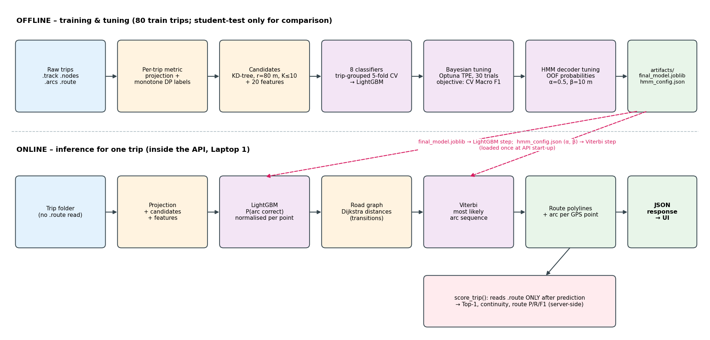
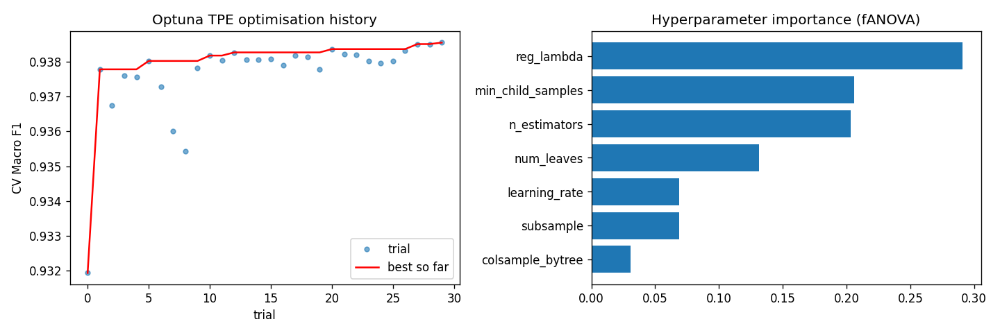
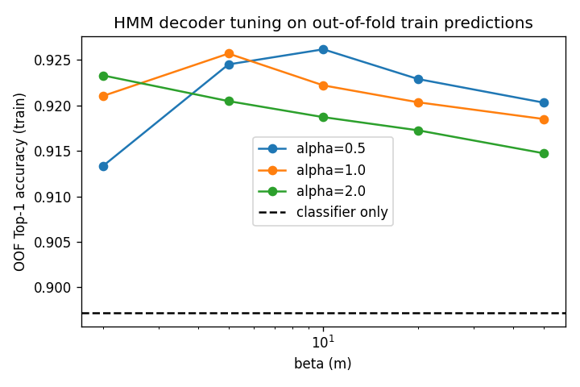
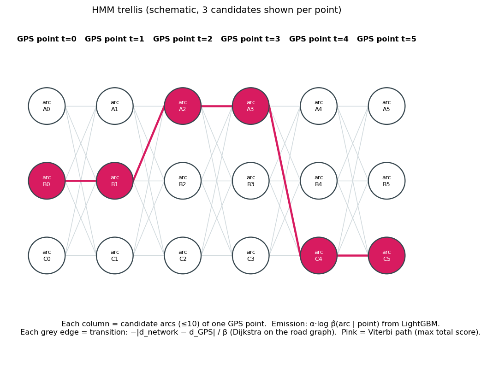
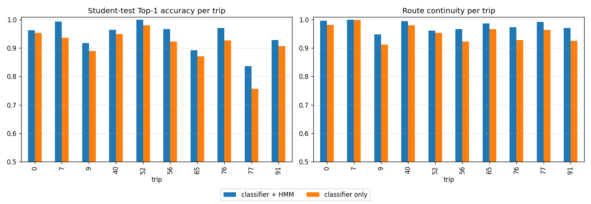
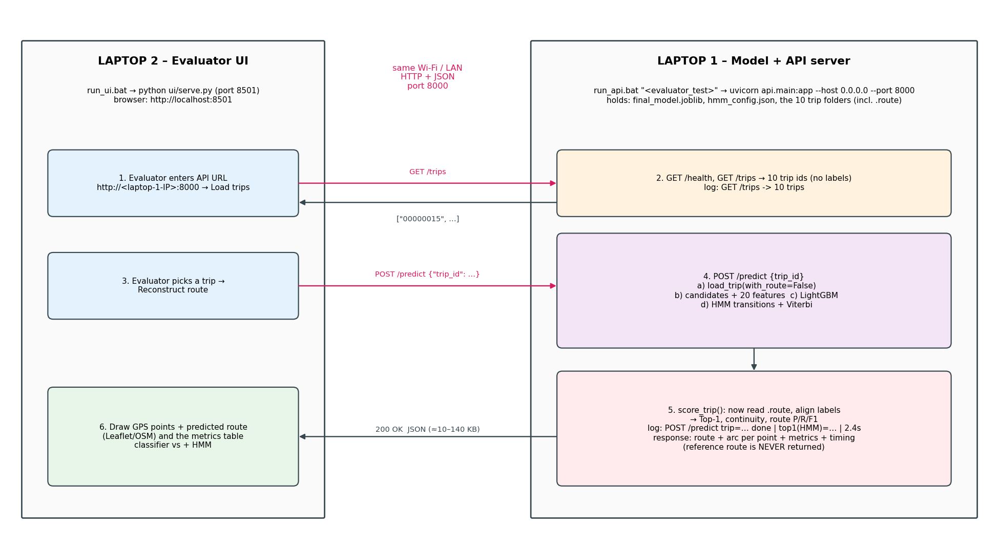
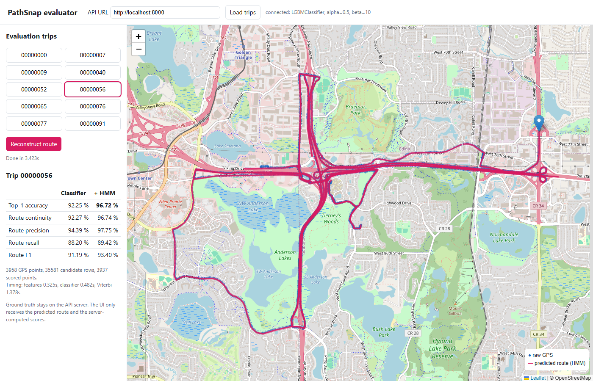
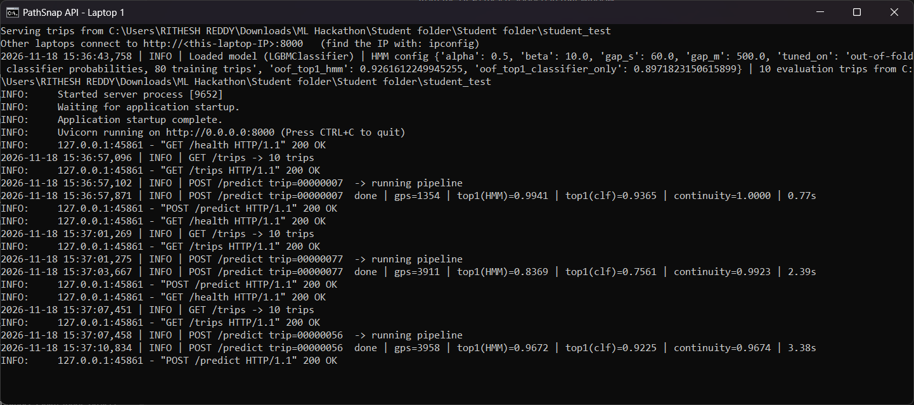

# PathSnap – Phase 2 Report: Pipeline, Optimisation, HMM and Two-Laptop Deployment

**Scope of Phase 2:** the complete pipeline end to end, model optimisation and decoder tuning, HMM/Viterbi route reconstruction, the FastAPI backend, the evaluator UI, and the two-laptop deployment.

Phase 1 (EDA, features, model comparison) is summarised only where it is needed.

Every number below is read from a file in `results/` produced by the scripts in this repository (seed 42).

---

## 1. The complete pipeline



The system has two halves.

**Offline (training and tuning; run once, on our laptop)**

| Step | What happens | Code | Output |
|---|---|---|---|
| 1. Load + project | Read `.track/.nodes/.arcs/.route`; sort fixes by time; project each trip to metres around its own centre | `pathsnap/data.py` | trip objects |
| 2. Labels | Monotone DP alignment of every GPS point to an arc of the reference route (points > 75 m away: no label) | `pathsnap/labels.py` | one reference arc per point |
| 3. Candidates + features | KD-tree over arcs; ≤ 10 arcs within 80 m per point; 20 features per (point, arc) | `pathsnap/candidates.py`, `scripts/02` | 1.74 M training rows |
| 4. Model selection | 8 classifiers, 5-fold CV grouped by trip → LightGBM | `scripts/03` | `results/models/` |
| 5. Feature selection | Correlation, ablation, top-k → keep all 20 | `scripts/03b` | `results/feature_selection/` |
| 6. Hyperparameter tuning | Optuna TPE, 30 trials, objective CV Macro F1 | `scripts/04` | `artifacts/final_model.joblib` |
| 7. Decoder tuning | α, β grid on **out-of-fold** probabilities of the 80 training trips | `scripts/05` | `artifacts/hmm_config.json` |

**Online (inference; runs inside the API for each request)**

| Step | What happens | Code |
|---|---|---|
| a | Load the selected trip **without** its `.route` | `load_trip(with_route=False)` |
| b | Candidates + 20 features (same code as training) | `build_trip_table()` |
| c | LightGBM gives P(arc is correct) for every candidate | `PathSnapModel.predict_trip()` |
| d | Road graph + Dijkstra gives transition costs; Viterbi gives the most likely arc per point | `pathsnap/hmm.py` |
| e | Build route polylines and the arc for each GPS point | `api/main.py::_lines()` |
| f | **Only now** read `.route` and score the prediction server-side | `api/main.py::score_trip()` |

The same `pathsnap/` code is used offline and online, so the features at inference are computed exactly as in training.

---

## 2. Optimisation and fine-tuning

Phase 2 contains **two separate tuning problems**, solved with different methods, and both use only training data.

### 2.1 Classifier: Bayesian hyperparameter optimisation (LightGBM)

| Item | Setting |
|---|---|
| Method | Optuna **TPE** (Tree-structured Parzen Estimator), seed 42, first 10 trials random |
| Objective | Mean 5-fold **trip-grouped** CV Macro F1 on the 80 training trips |
| Trials / cost | 30 trials, 150 model fits, 1,546 s (≈ 26 min) |
| Search space | n_estimators 100–800 · learning_rate 0.01–0.2 (log) · num_leaves 15–255 (log) · min_child_samples 5–200 (log) · subsample 0.5–1 · colsample_bytree 0.4–1 · reg_lambda 1e-3–10 (log) |
| Best | n_estimators 600, learning_rate 0.014, num_leaves 221, min_child_samples 12, subsample 0.62, colsample_bytree 0.49, reg_lambda 0.17 |

**How TPE works.** After each trial, TPE splits the trials so far into "good" (top scores) and "bad". It fits a probability density to each group's hyperparameters, and proposes the next trial where the ratio good/bad is highest. Compared with grid or random search, it spends more trials in the promising region.

| | CV Macro F1 | CV Top-1 | CV Log loss | Student-test Top-1 | Inference |
|---|---|---|---|---|---|
| LightGBM untuned | 0.9367 ± 0.013 | 0.8889 | 0.0774 | **0.8991** | 0.034 ms/pt |
| LightGBM tuned | **0.9386 ± 0.012** | **0.8908** | **0.0732** | 0.8945 | 0.087 ms/pt |



**Interpretation**

- Tuning improved every CV metric, but by less than the fold-to-fold standard deviation. On student-test it was slightly lower.
- The defaults were already close to optimal.
- The tuned model was kept because the selection rule (CV on training trips only) was fixed before looking at test results.
- The most important hyperparameters (fANOVA) were reg_lambda (0.29), min_child_samples (0.21) and n_estimators (0.20).

### 2.2 Decoder: tuning the HMM parameters α and β

The HMM has two weights (see Section 3): **α** scales the classifier's emission score and **β** (metres) scales the distance-mismatch penalty. They were chosen by grid search:

- **Grid:** α ∈ {0.5, 1, 2} × β ∈ {2, 5, 10, 20, 50} m, 15 configurations.
- **Data:** out-of-fold (OOF) LightGBM probabilities on all 80 training trips. Each trip's probabilities come from a model that **never saw that trip** (5-fold by trip). Using in-sample probabilities would be overconfident and would bias the decoder towards trusting the classifier too much.
- **Objective:** mean pointwise Top-1 accuracy after Viterbi decoding.

**OOF Top-1 after decoding** (`results/hmm/decoder_grid_oof_train.csv`). Classifier alone: **0.8972**.

| α \ β (m) | 2 | 5 | 10 | 20 | 50 |
|---|---|---|---|---|---|
| 0.5 | 0.9133 | 0.9245 | **0.9262** | 0.9229 | 0.9203 |
| 1.0 | 0.9210 | 0.9257 | 0.9222 | 0.9203 | 0.9185 |
| 2.0 | 0.9233 | 0.9205 | 0.9187 | 0.9173 | 0.9147 |



**Chosen: α = 0.5, β = 10 m.**

**Why the grid has a "ridge".**

- The Viterbi path only depends on the **ratio** between emission and transition weights. Multiplying the whole score by a constant doesn't change the best path, and α·log p − d/β = α·(log p − d/(α·β)).
- So the effective parameter is **α·β**. The three best cells all have α·β ≈ 4–5: (0.5, 10) → 5, (1, 5) → 5, (2, 2) → 4.
- In plain terms: a **distance mismatch of about 5 m counts as much as a factor-e change in classifier probability**.

The gap thresholds (60 s, 500 m) were set by reasoning, not tuned: 60 s at urban speeds is roughly 500 m–1 km of unobserved driving.

---

## 3. HMM and Viterbi route reconstruction



### 3.1 Why an HMM

The classifier scores each GPS point on its own. That produces routes that jump to a parallel street for one second, or flip between the two directions of a two-way road. A vehicle can't do that. The HMM adds the constraint that **consecutive points must be connected through the road network by a plausible driving distance**.

### 3.2 Model definition

| Part | Our implementation |
|---|---|
| Hidden state at time t | One of the candidate arcs C_t of GPS point t (≤ 10). The state also stores the projection position `t_proj` along the arc. |
| Observation | The GPS fix z_t |
| Emission | log P(z_t \| a) = **α · log p̂(a \| z_t)**: LightGBM probability **normalised over C_t**, floored at 1e-4 |
| Transition | log P(b \| a) = **−\|d_net(a→b) − d_gc(t,t+1)\| / β** |
| d_gc | Straight-line distance between the two GPS fixes |
| d_net, a ≠ b | (rest of arc a after the projection) + **Dijkstra** shortest path from end-node(a) to start-node(b) + (part of arc b up to the projection) |
| d_net, a = b | Forward movement along the arc. Backward movement ≤ 10 m counts as GPS jitter; more is penalised ×4. |
| Unreachable | No path within the search limit (3·d_gc + 150 m) → log P = −50 (a large finite penalty, so decoding never fails) |
| Gap | dt > 60 s or d_gc > 500 m → **flat** transitions: the chain restarts, and each side is decoded from its own evidence |

**Intuition for the transition:** if the car moved 12 m between fixes and the road path between two candidate arcs is also about 12 m, the transition is likely. If the road path is 300 m (for example, going round the block to reach the parallel street), it is very unlikely.

### 3.3 Viterbi recurrence

```
δ_0(a)   = α · log p̂_0(a)
δ_t(b)   = max_a [ δ_{t-1}(a) + log P(b | a) ] + α · log p̂_t(b)
ψ_t(b)   = argmax_a [ δ_{t-1}(a) + log P(b | a) ]          (back-pointer)
a*_T     = argmax_b δ_T(b);   a*_{t-1} = ψ_t(a*_t)          (backtrack)
```

- **Complexity:** O(T · K²) score updates, plus Dijkstra searches (K ≤ 10, so at most 100 transitions per step).
- **Efficiency:** Dijkstra is limited to 3·d_gc + 150 m, and its result is **cached per source node** and reused whenever a later step starts from the same node.
- **Numerical stability:** scores are re-centred at every step.
- Precomputing all 80 training trips' transition tables took 75 s.

### 3.4 Results – classifier only vs classifier + HMM (10 student-test trips)

| Method | Top-1 (trip mean) | Top-1 (all points) | Continuity | Route precision | Route recall | Route F1 |
|---|---|---|---|---|---|---|
| Classifier only | 0.9094 | 0.8945 | 0.9535 | 0.9144 | 0.8957 | 0.9030 |
| **Classifier + HMM** | **0.9435** | **0.9348** | **0.9794** | **0.9625** | **0.9056** | **0.9316** |



**What the HMM fixed**

- It improved Top-1 on **all 10** student-test trips; the largest gain was trip 77, from 0.756 to 0.837.
- Continuity rose from 0.954 to 0.979: far fewer impossible jumps.
- Route precision rose from 0.914 to 0.963: fewer wrong side streets in the reconstructed route.

**What it could not fix**

1. **Route recall stays at about 0.90.** Some route arcs are shorter than the distance driven in one second, so no GPS point is ever matched to them. Even perfect per-point labels reach only **0.905 mean recall**, so the HMM is already at that ceiling. The fix would be *path interpolation*: inserting the Dijkstra path between consecutive matched arcs.
2. **Direction ambiguity.** On trip 77, **77 % of the remaining errors are the reverse-direction twin of the correct arc**. In the worst 300-point window, 122 of the 124 points where the classifier and HMM disagree are such twins. The HMM still gets 85.3 % of that window right, against 52.7 % for the classifier alone.
3. HMM smoothing can in principle override a correct but isolated classifier decision, for example a genuine short detour. Lowering α·β trades smoothing for trust in the classifier.

---

## 4. API and two-laptop deployment



### 4.1 Roles of the two laptops

| | Laptop 1 – Model + API | Laptop 2 – Evaluator UI |
|---|---|---|
| Start | `run_api.bat "<evaluator_test folder>"` | `run_ui.bat` |
| Process | `uvicorn api.main:app --host 0.0.0.0 --port 8000` | `python ui/serve.py 8501` (static web server) |
| Holds | Code, `final_model.joblib`, `hmm_config.json`, the 10 trip folders **including `.route`** | Only `ui/index.html`: no data, no model, no labels |
| Shows | Console log of every request (trip, accuracy, timing) | Map with GPS + predicted route, and the metrics table |

**Network setup**

1. Both laptops join the same Wi-Fi or LAN.
2. On Laptop 1, find its IPv4 address with `ipconfig`, for example 192.168.1.23.
3. Allow inbound TCP port 8000 on Laptop 1: accept the Windows Firewall prompt the first time the API starts, or run the command below as administrator.
4. On Laptop 2, open `http://localhost:8501` and enter `http://192.168.1.23:8000` as the API URL.

```
netsh advfirewall firewall add rule name="PathSnap API" dir=in action=allow protocol=TCP localport=8000
```

`--host 0.0.0.0` makes uvicorn accept connections from other machines, not just localhost. CORS is enabled in the API, so the page served from Laptop 2 is allowed to call Laptop 1.

### 4.2 Request flow (one evaluation)

| # | Where | What happens | API console log |
|---|---|---|---|
| 1 | Laptop 2 | Evaluator enters the API URL and clicks **Load trips** | |
| 2 | Laptop 1 | `GET /health` (model + α, β) and `GET /trips` return the 10 trip ids, with no labels | `GET /trips -> 10 trips` |
| 3 | Laptop 2 | Evaluator selects a trip and clicks **Reconstruct route**, which sends `POST /predict {"trip_id": …}` | `POST /predict trip=… -> running pipeline` |
| 4 | Laptop 1 | Pipeline steps a–e (Section 1): load trip without route → candidates/features → LightGBM → Dijkstra + Viterbi | |
| 5 | Laptop 1 | `score_trip()` reads `.route`, aligns labels and computes Top-1, continuity and route P/R/F1 for HMM and classifier-only | `POST /predict trip=… done` with gps count, top1(HMM), top1(clf), continuity and time |
| 6 | Laptop 2 | Draws the GPS points and predicted route on an OpenStreetMap basemap, plus the metrics table | |

### 4.3 API endpoints and response

| Method | Path | Body | Returns | Errors |
|---|---|---|---|---|
| GET | `/health` | – | status, model type, decoder config, number of trips | – |
| GET | `/trips` | – | `{"trips": [10 ids]}` | – |
| POST | `/predict` | `{"trip_id": "00000007"}` | see below | 404 for an unknown trip (tested) |

Real response for student-test trip 7, with long arrays shortened (`results/phase2/example_predict_response.json`):

```json
{
  "trip_id": "00000007", "n_gps": 1354, "n_candidates": 7226,
  "gps": [[43.388762, 77.122052], [43.388809, 77.122188], "..."],
  "predicted_route": [[[43.38871, 77.121921], [43.38896, 77.122525], "..."], "..."],
  "predicted_arc_per_obs": [520, 520, 520, 520, 2166, "..."],
  "metrics": {
    "hmm":             {"top1_accuracy": 0.9941, "n_scored_obs": 1354, "route_precision": 0.9837, "route_recall": 0.9837, "route_f1": 0.9837},
    "classifier_only": {"top1_accuracy": 0.9365, "n_scored_obs": 1354, "route_precision": 0.9837, "route_recall": 0.9837, "route_f1": 0.9837},
    "route_continuity_hmm": 1.0, "route_continuity_classifier": 0.9985
  },
  "timing_s": {"candidates_features": 0.086, "classifier": 0.071, "hmm_viterbi": 0.308, "total": 0.465, "request_total": 0.602}
}
```

### 4.4 Ground-truth isolation (no leakage, no hard-coding)

- Prediction calls `load_trip(..., with_route=False)`, so the model never sees the route.
- The `.route` file is opened only inside `score_trip()`, **after** the prediction is finished, and only to compute scores.
- The response contains the **predicted** route and the scores, never the reference route. We checked all 10 evaluator responses for any reference field.
- There are no stored predictions. Every request recomputes the full pipeline, which the console timing shows.

### 4.5 Latency (10 student-test trips, `results/phase2/api_latency_student_test.csv`)

| Stage | Mean (s) | Max (s) | Share of pipeline |
|---|---|---|---|
| Candidates + features | 0.186 | 0.390 | 20 % |
| LightGBM | 0.163 | 0.373 | 17 % |
| HMM transitions + Viterbi | 0.601 | 1.316 | 63 % |
| **Pipeline total** | **0.950** | **1.968** | 100 % |
| Whole request (incl. scoring + JSON) | 1.285 | 3.167 | |

- The HMM dominates the cost, mainly through the Dijkstra searches.
- About 0.34 s per request (mean) goes on server-side scoring and building the JSON. Scoring aligns the labels once for the HMM and once for the classifier-only scores, so caching that alignment is an easy optimisation if needed.
- Responses are 9–141 KB of JSON. For drawing, the API sends every k-th GPS point with k = ⌊n / 2000⌋ (all points for trips under 4,000 points).

### 4.6 The UI

`ui/index.html` is a single static page: Leaflet with an OpenStreetMap basemap, and no build step. It:

- loads the trip list from the API, sends the selected trip, and draws the GPS points and the predicted route
- shows a table comparing **classifier vs + HMM** (Top-1, continuity, route precision, recall, F1) and the per-stage timing
- accepts a deep link `?api=…&trip=…` for quick demos

The UI never receives or computes labels.





---

## 5. Engineering issues found and fixed during Phase 2

| Issue | Effect | Fix |
|---|---|---|
| Uvicorn's coloured log output in a classic CMD window | Log lines full of `←[32m` codes | `--no-use-colors` in `run_api.bat` |
| `<`/`>` in an `echo` line of `run_api.bat` | CMD treated them as redirection ("cannot find the file") | Escaped as `^<`/`^>` |
| Batch files with LF line endings | Fragile in CMD | Converted to CRLF; `.gitattributes` keeps `*.bat` as CRLF |
| Dense GPS dots hid the predicted route in the UI | Route hard to see | Route drawn above smaller, semi-transparent GPS dots |
| HistGradientBoosting early stopping and other reported details | Report statements didn't match the actual configuration | Every claim re-checked against the code and output files |

---

## 6. Evaluator data – deployment dry run

The evaluator trips (`evaluator_test.zip`, 10 trips) were received for deployment. They are stored **outside** the repository (`evaluator_data/`) and are not committed.

They were used **only** to check that the API and UI run end to end on every trip:

- All 10 trips returned HTTP 200 in 0.3–3.5 s per request.
- No response contained reference-route fields.

**Nothing was trained, tuned or changed based on the evaluator data.** The model, features, α, β and thresholds are exactly those chosen on training data in Section 2. Evaluator accuracies are produced live by the API during evaluation and are not part of this report.

---

## 7. How to run (evaluation day)

```text
Laptop 1:  run_api.bat "C:\path\to\evaluator_test"      (wait for "Uvicorn running on http://0.0.0.0:8000")
           ipconfig  → note the IPv4 address
Laptop 2:  run_ui.bat                                    (opens http://localhost:8501)
           API URL = http://<laptop-1-IPv4>:8000 → Load trips → pick a trip → Reconstruct route
Show:      the request log in the Laptop 1 console after every evaluation
```

**Troubleshooting**

- *"Cannot reach API"*: check the same network, the firewall rule for port 8000, and the IP address.
- *No map background*: the basemap tiles need internet. The route and metrics still work without it.
- *Port already in use*: close the old API window, or stop the old `python` process.

---

## 8. Limitations and next steps

1. **Direction ambiguity on two-way roads** is the main remaining error source. A direction-consistency term in the transition (penalising U-turns without a stop) is the natural next step.
2. **Route recall ceiling (~0.905):** add path interpolation between matched arcs.
3. **Latency:** cache the label alignment in `score_trip()`, and run Dijkstra once per arc pair instead of per point.
4. **Decoder tuning** used a 15-point grid; a finer or Bayesian search over α·β (the effective parameter) would be cheap.

---

## 9. Reproducing Phase 2

```bash
python scripts/04_bayes_opt.py         # tuned LightGBM + OOF probabilities
python scripts/05_hmm_eval.py          # decoder grid, student-test comparison, maps, hmm_config.json
python scripts/07_report_figures.py    # screenshots and figures (API + UI must be running)
python scripts/08_phase2_diagrams.py   # diagrams in this report
python scripts/md_to_pdf.py PHASE2_REPORT.md
```

---

*AI-assistance disclosure: an AI coding assistant (Claude) helped develop the code and draft this report. All experiments were executed, and all numbers, tables and figures come from the code and result files in this repository.*
